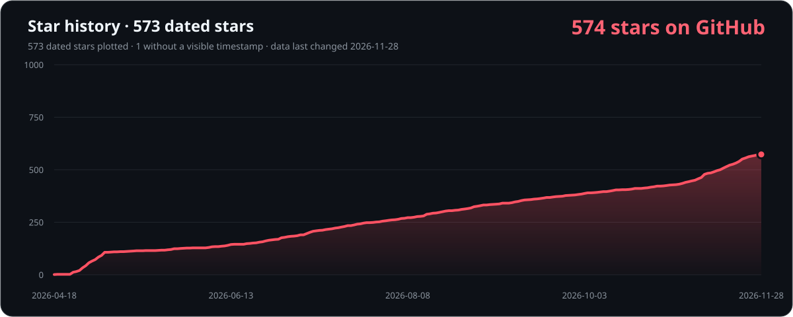

<p align="center">
  <a href="./README.md">繁體中文</a> · <a href="./README.zh-CN.md">简体中文</a> · <a href="./README.en.md">English</a> · <a href="./README.ja.md">日本語</a> · <strong>ไทย</strong>
</p>

<h1 align="center">UAV Downloader</h1>

<p align="center">
  โปรแกรมดาวน์โหลดและเฝ้าดูหมวดหมู่อัตโนมัติสำหรับเดสก์ท็อป รองรับ JableTV, MissAV, SupJav, Hanime1 และ Huangguo พร้อม<strong>ระบบสร้างซับไตเติล AI ในตัว</strong><br />
  <strong>ดาวน์โหลดวิดีโอก่อน แล้วสร้างซับไตเติล AI อัตโนมัติ:</strong> ถอดเสียงภาษาญี่ปุ่นในเครื่องเพื่อสร้างไฟล์ SRT ภาษาญี่ปุ่น อังกฤษ และจีนดั้งเดิม<br />
  ใช้ <strong>UAV Browser</strong> เพื่อเรียกดูและเลือกวิดีโอเอง หรือใช้ <strong>UAV Watcher</strong> เพื่อติดตามหมวดหมู่ที่เลือกอย่างต่อเนื่อง<br />
  <strong>จุดเด่นหลักคือการทำงานอัตโนมัติแบบไร้คนเฝ้า:</strong> ตั้งค่าหมวดหมู่และตารางเวลาเพียงครั้งเดียว จากนั้นระบบจะค้นหาเรื่องใหม่ ตัดเรื่องซ้ำ ดาวน์โหลด และสร้างซับไตเติลให้อัตโนมัติ
</p>

<p align="center">
  <a href="https://github.com/Alos21750/UAV-Downloader/releases/latest"></a>
  <a href="https://github.com/Alos21750/UAV-Downloader/releases"></a>
  <a href="https://github.com/Alos21750/UAV-Downloader"></a>
  <a href="./LICENSE"></a>
  <a href="https://github.com/Alos21750/UAV-Downloader/pkgs/container/uav-downloader"></a>
</p>

<p align="center">
  <strong><a href="https://github.com/Alos21750/UAV-Downloader/releases/latest/download/UAV_Browser.exe">ดาวน์โหลด UAV Browser</a></strong>
  ·
  <strong><a href="https://github.com/Alos21750/UAV-Downloader/releases/latest/download/UAV_Watcher.exe">ดาวน์โหลด UAV Watcher</a></strong>
  ·
  <a href="https://github.com/Alos21750/UAV-Downloader/releases/latest">UAV Watcher portable ZIP (v3.1.0+)</a>
  ·
  <a href="https://github.com/Alos21750/UAV-Downloader/releases/latest">ดูเวอร์ชันล่าสุด</a>
</p>

> [!TIP]
> **ทำงานในเครื่องทั้งหมดตามค่าเริ่มต้น ไม่ต้องใช้ API Key และไม่อัปโหลดข้อมูล** หลังดาวน์โหลดเสร็จ UAV Browser และ UAV Watcher สามารถสร้างไฟล์ `.ja.srt`, `.en.srt` และ `.zh-TW.srt` แยกข้างไฟล์เพื่อสลับภาษาได้โดยไม่แก้ไขไฟล์ MP4 คุณสามารถเลือกเชื่อมต่อ LLM API ทั่วไปเพิ่มเติมได้ โดยข้อความซับไตเติลที่ถอดเสียงได้จะเป็นข้อมูลจากสื่อเพียงอย่างเดียวที่ถูกส่งออกไป พร้อมข้อมูลยืนยันตัวตน API ที่จำเป็นและข้อมูลการเชื่อมต่อทั่วไปเท่านั้น ไม่มีการส่งไฟล์วิดีโอหรือเสียง

<p align="center">
  
</p>

## 3 โหมดการทำงาน บนแกนดาวน์โหลดเดียวกัน

### v3.7.0: หน้าตาโปรแกรมที่อ่านง่ายขึ้นและกำหนดเพดานความเร็วดาวน์โหลดได้

- ปรับขนาดตัวอักษรขนาดเล็กให้คมชัดขึ้น จัดตำแหน่งคำอธิบาย และเพิ่มคอนทราสต์ในโหมดสว่าง/มืด หน้าตั้งค่าของ Watcher จัดวางเป็นการ์ดที่ปรับคอลัมน์ตามขนาดหน้าต่างและไม่บังแถบปุ่มด้านล่างในหน้าต่างเตี้ย
- กรอก **เพดาน MB/s** ได้ที่หน้าหลัก Watcher หรือแถบเครื่องมือดาวน์โหลด/ตั้งค่าของ Browser เช่น `2.5`; ค่า `0` คือไม่จำกัด รองรับช่วง `0.01–10000` และบันทึกค่าเมื่อกด Enter ย้ายโฟกัส หรือปิดหน้าต่างตามปกติ
- เวิร์กเกอร์ดาวน์โหลดสื่อทั้งหมด**ภายในโปรเซสเดียวกันจะใช้เพดานความเร็วร่วมกัน** หน่วย MB/s ใช้ฐาน 1024² ไบต์ อาจเกิดช่วงเร็วเกินชั่วคราวจากบัฟเฟอร์ซ็อกเก็ต ส่วนโปรแกรมที่เปิดแยกหน้าต่างและการดาวน์โหลดโมเดล AI จะคิดแยกต่างหาก
- ตอบสนองต่อการยกเลิกหรือเปลี่ยนเป็นไม่จำกัดความเร็วได้เร็วขึ้น ลดการวาดหน้าจอซ้ำซ้อน แปลปุ่มควบคุมคิวครบถ้วน และเพิ่มคำแนะนำเมื่อคิวว่าง
- การรวมตอน Huangguo ยังต้องใช้สตรีมที่เข้ากันได้เท่านั้น **ไม่มีการแปลงรหัสอัตโนมัติ**ในรุ่นนี้ แม้ความละเอียดที่แสดงจะเท่ากันแต่โคเดก ไทม์เบส หรือการตั้งค่าเสียงอาจต่างกัน หากเข้ากันไม่ได้ระบบจะหยุดอย่างปลอดภัยและเก็บแคชของแต่ละตอนไว้

### v3.6.0: รวมตอน Huangguo — ทุกตอนเป็น MP4 ไฟล์เดียว

- ใน **UAV Watcher → แสดงการตั้งค่า (Show settings)** สามารถเปิดใช้งาน **Huangguo: รวมทุกตอนเป็น MP4 ไฟล์เดียว** โดยค่าเริ่มต้นจะปิดไว้ และการดาวน์โหลดแยกตอนแบบเดิมยังคงไม่เปลี่ยนแปลง การตั้งค่าจะมีผลในการสแกนรอบถัดไปและใช้กับงาน Huangguo ใน Watcher เท่านั้น
- ตอนของเรื่องเดียวกันจะถูกรวมตาม**ลำดับหมายเลข EP** โดยใช้ตอนที่พบจริงในการสแกนรอบนั้น ไม่ได้หมายความว่าเรื่องนั้นจบสมบูรณ์แล้ว เมื่อพบตอนใหม่ระบบจะสร้างไฟล์รวมใหม่ทั้งหมด และแทนที่ไฟล์รวมเดิมแบบอะตอมิกเมื่อสำเร็จเท่านั้น
- ใช้โฟลเดอร์ปลายทางรายเว็บไซต์และตัวกรองวันที่อัปเดตเรื่องของ Huangguo โดยจะเก็บแคชของแต่ละตอนไว้สำหรับทำต่อเมื่อสะดุดหรือรวมตอนใหม่เพิ่มเติม จึงต้องเผื่อพื้นที่ดิสก์เพิ่มเติม
- หากมีตอนขาดหายหรือดาวน์โหลดตอนใดไม่สำเร็จ ระบบจะชะลอการรวมไฟล์แทนที่จะข้ามตอนนั้นไปเฉยๆ หากรูปแบบวิดีโอ/เสียงเข้ากันไม่ได้จะแจ้งข้อผิดพลาดชัดเจนและเก็บแคชไว้ การรวมไฟล์ใช้วิธีคัดลอกสตรีมโดยตรง ไม่แปลงรหัสใหม่หรือฝืนแปลงไฟล์ที่เข้ากันไม่ได้
- Browser, CLI และคิวดาวน์โหลด Web ยังคงดาวน์โหลดแยกเป็นรายตอนตามเดิม ฟีเจอร์นี้ไม่ได้เพิ่มระบบรู้จำเสียงภาษาจีน และการรวมวิดีโอไม่ได้สร้างซับไตเติลภาษาจีนให้อัตโนมัติ

### v3.5.1: แก้ไขการดึงลิงก์เล่นวิดีโอ Huangguo และ Watcher

- รองรับการดึงข้อมูลเล่นวิดีโอแบบไม่ระบุตัวตนรูปแบบใหม่ของ Huangguo เนื่องจากหน้าเว็บไม่ฝัง URL เล่นวิดีโอไว้ใน HTML แล้ว โดยใช้งานผ่านปลายทางสาธารณะปกติ ไม่มีการนำเข้าข้อมูลเข้าสู่ระบบหรือข้ามข้อจำกัดการเข้าถึง
- Watcher จะไม่ระบุความล้มเหลวในการหาต้นทางว่าเป็น `invalid URL` หรือข้ามรายการนั้นถาวรอีกต่อไป การสแกนที่ล้มเหลวจะถูกทำเครื่องหมายว่ายังไม่สมบูรณ์เพื่อรอลองใหม่ รายการที่เคยถูกข้ามผิดพลาดจากรุ่นเก่าจะถูกตรวจสอบใหม่โดยไม่ลบไฟล์ที่โหลดสำเร็จแล้วหรือรายการที่คัดออกตามวันที่/เวอร์ชัน
- นำ PR #66 ที่ผ่านการตรวจสอบอิสระมาใช้งาน เพื่อกู้คืนชื่อเรื่อง Hanime1 ที่ขาดหายจากหน้าดาวน์โหลดของวิดีโอเดียวกัน โดยไม่ทิ้งแหล่งวิดีโอที่ใช้งานได้หากการดึงชื่อเรื่องเสริมล้มเหลว
- ยังคงใช้อินเทอร์เฟซเดสก์ท็อปเดิม ไม่มีการย้ายไปใช้ Qt/Tauri ดูเพิ่มเติมที่ [บันทึกการตรวจสอบบำรุงรักษา](docs/maintenance/2026-11-15-issue-audit.md)

### v3.5.0: ความลื่นไหลและความเสถียร

- แคชข้อมูลตอนของ Huangguo ในหน่วยความจำแบบจำกัดขนาดและอายุการใช้งานสั้น พร้อมรวมคำขอที่ซ้ำกันในเวลาเดียวกัน และล้างแคชตามเครื่องหมายอัปเดต โดยไม่แคช URL เล่นวิดีโอหรือส่วนหัวการยืนยันตัวตน
- การเปลี่ยนหน้า การยกเลิกการสแกน และการหยุด Watcher จะส่งผลถึงงานดึงข้อมูลของ Huangguo แล้ว การเชื่อมต่อเครือข่ายที่ค้างอยู่อาจรอจนครบ timeout ที่จำกัดไว้ วันที่อัปเดตที่มี timezone offset จะถูกปรับเทียบตามปฏิทินไทเป
- Watcher สร้างหมวดหมู่ของแต่ละเว็บไซต์เมื่อเปิดดูเป็นชุดเล็กๆ และหน่วงเวลาการกรองคำค้นหา พร้อมคงค่าที่เลือกไว้สำหรับเว็บไซต์ที่ไม่ได้เปิดและโฟลเดอร์/วันที่รายเว็บไซต์
- แยกความแตกต่างระหว่างความล้มเหลวจากพร็อกซี/เครือข่าย ข้อผิดพลาด HTTP ทั่วไป และการตรวจสอบจากเว็บไซต์ รวมถึงแก้ไขการแปลง URL ย่อยของ HLS ที่มีเฉพาะ query หลังการเปลี่ยนเส้นทาง manifest
- ดู [บันทึกการตรวจสอบ issue/PR](docs/maintenance/2026-11-10-issue-audit.md) และ [บทวิจารณ์การออกแบบและใบอนุญาต HGhub](docs/hghub-review.md) โดย UAV ยังคงใช้สัญญาอนุญาต Apache-2.0 และไม่ได้คัดลอกโค้ดส่วนที่ติดสัญญาอนุญาตแบบห้ามใช้งานเชิงพาณิชย์จาก HGhub

### ใหม่ใน v3.4.0: รองรับละครสั้น Huangguo

- URL ตอนสาธารณะของ Huangguo ใช้งานได้ทั้งใน Browser, Watcher, CLI และคิวดาวน์โหลด Web
- Browser/Watcher เพิ่มหมวดหมู่ละครสั้น AI และแอนิเมชัน AI รายการหมวดหมู่จะขยายเฉพาะลิงก์ตอนที่มีอยู่จริงบนเว็บ ไม่เดาสร้างหมายเลขตอนที่ขาดหาย การวาง URL ตอนโดยตรงจะโหลดเฉพาะตอนนั้น ส่วน URL หลักของเรื่องหมายถึงตอนที่ 1
- ตัวระบุตอนที่มีชื่อเว็บไซต์นำหน้าช่วยป้องกันการชนกันของชื่อเรื่องหรือตอน และ Watcher รองรับทั้งการตั้งค่าโฟลเดอร์/วันที่แบบใช้ร่วมกันหรือแยกเฉพาะเว็บไซต์
- การกรองวันที่ของ Huangguo ใช้ **วันที่อัปเดตเรื่อง** จากเว็บไซต์ ไม่ใช่วันที่เผยแพร่ของแต่ละตอน ตอนในเรื่องเดียวกันจึงอาจใช้วันที่เดียวกัน หากระบุวันที่ไม่ได้ระบบจะข้ามรายการนั้นและไม่ทึกทักว่าเป็นวันนี้
- ปัจจุบันรองรับ HLS ที่ใช้เซกเมนต์ MPEG-TS เท่านั้น ยังไม่รองรับ fMP4, DASH หรือโปรโตคอลเครื่องเล่นเฉพาะ ภาพปกที่เข้ารหัสของเว็บไซต์จะไม่ถูกถอดรหัส โดยหน้าจอจะแสดงภาพแทนที่
- ไม่มีการข้ามการเข้าสู่ระบบ การชำระเงิน หรือการควบคุมการเข้าถึง ระบบซับไตเติลยังคงเน้นภาษาญี่ปุ่นเป็นหลัก และไม่ได้เพิ่มโมเดลรู้จำเสียงภาษาจีน

### แก้ไขใน v3.3.1

- SupJav FST เลือกแหล่งวิดีโอตามลำดับความสำคัญของเครื่องเล่น รองรับทั้ง URL สัมพัทธ์และ URL ที่ระบุชัดว่าเป็น HLS แม้ไม่ลงท้ายด้วย `.m3u8` ทั้งนี้ความคมชัดจริงขึ้นอยู่กับผู้ให้บริการต้นทาง
- หน้าเว็บที่ผิดพลาดจะไม่ถูกตีความว่าเป็นผลการค้นหาที่ว่างเปล่าอีกต่อไป หากการตอบสนองจากค่าที่บันทึกไว้ใช้งานไม่ได้ ระบบจะลองเส้นทางคำขอปกติสำรองต่อ ส่วนการบล็อกของ Cloudflare ที่เกิดขึ้นจริงยังคงแสดงเป็นข้อผิดพลาด ไม่รับประกันการข้ามผ่าน
- Watcher จะทำเครื่องหมายความล้มเหลวในการดึงรายการว่ายังไม่สมบูรณ์เพื่อรอลองใหม่ แทนการบันทึกผิดพลาดว่าการสแกนครั้งแรกเสร็จสิ้นแล้ว โดยเว็บไซต์อื่นที่ปกติจะทำงานต่อไป

### ใหม่ใน v3.3.0

- อินเทอร์เฟซภาษาไทยและคู่มือภาษาไทย พร้อมการควบคุมคิวแบบบันทึกถาวรที่ครบขึ้น: นำเข้า/ส่งออก ตัวกรอง หยุดชั่วคราว/ทำต่อ ตั้งเวลาทำงาน และลองใหม่แบบจำกัดจำนวนครั้ง
- [Docker Web UI เสริม](docs/docker-cli.md#nas-web-queue-opt-in): คิว URL แบบบันทึกถาวรที่ต้องยืนยันตัวตน แสดงความคืบหน้า ยกเลิก/ลองใหม่ และหยุดเมื่อเกิดข้อผิดพลาดดิสก์ โดย CLI ยังคงเป็นค่าเริ่มต้น
- ปุ่ม **ดูตัวอย่าง (Preview ↗)** ข้างปุ่มเลือกจะเปิดหน้าเครื่องเล่นฉบับเต็มของต้นทางในเบราว์เซอร์ของระบบโดยไม่ดาวน์โหลด ส่วนการเล่นวิดีโอในโปรแกรมโดยตรงยังเป็นข้อเสนอที่เปิดรับอยู่
- ปรับปรุงเทมเพลตชื่อไฟล์ การจำแนกเวอร์ชันของ MissAV การตรวจสอบ URL/พาธ การส่งออก CSV และการวินิจฉัยพื้นที่จัดเก็บ การสแกนผลลัพธ์ทั้งหมดจะไม่หยุดเงียบๆ ที่หน้า 50 อีกต่อไป

### เวอร์ชันก่อนหน้า: v3.2.1

แก้ไขปัญหา race condition เมื่อปิด Browser ทันทีระหว่างเริ่มเปิดโปรแกรม และย้ายการอัปเดต UI จากเบื้องหลังกลับมาทำงานบนเธรดหลักทั้งหมด

- สร้างซับไตเติลให้วิดีโอที่มีอยู่แล้วได้จากเมนู ดาวน์โหลด → สร้างซับให้ไฟล์ในเครื่อง (Subtitle Local Files)
- เปิดใช้งานการจัดคิวใหม่เมื่อดาวน์โหลดช้าหรือค้างได้ในหน้าตั้งค่า (ปิดเป็นค่าเริ่มต้น)
- Watcher สแกนเกินขีดจำกัดเดิมที่ 50 หน้าได้แล้ว และเก็บทุกเวอร์ชันที่ปล่อยออกมาแยกไว้ในโฟลเดอร์ `versions/<kind>` ภายใต้ปลายทางของแต่ละเว็บไซต์
- SupJav รองรับแหล่ง EVS, VAS, LUC และ VOE เพิ่มเติมจากแหล่งเดิม โดย HTTP 429 จะรอแล้วลองใหม่ ส่วนการติด 403 จริงยังคงต้องใช้ session ที่ถูกต้อง
- ข้อผิดพลาดในการเขียนไฟล์ปลายทางจะหยุดการดาวน์โหลดทันทีแทนการลองใหม่แบบข้อผิดพลาดเครือข่าย กรุณาตรวจสอบอุปกรณ์จัดเก็บข้อมูลก่อนกดทำต่อด้วยตนเอง

| สิ่งที่ต้องการทำ | เลือกใช้ | ขั้นตอนการทำงาน |
|---|---|---|
| เรียกดู ค้นหา และเลือกดาวน์โหลดทีละเรื่อง | **UAV_Browser.exe** | เรียกดูการ์ด เลือกหลายเรื่อง เข้าคิว หรือดาวน์โหลดทันที |
| ติดตามเรื่องใหม่แบบอัตโนมัติไร้คนเฝ้า | **UAV_Watcher.exe** | เลือกเว็บไซต์ หมวดหมู่ วันที่ ลำดับเวอร์ชัน และตารางเวลา จากนั้นการค้นหา ตัดซ้ำ ดาวน์โหลด และสร้างซับจะทำงานอัตโนมัติ |
| Defender แจ้งเตือนบนไฟล์เดี่ยวของ UAV Watcher | **UAV_Watcher_portable.zip** | ตรวจสอบแฮชและรายละเอียดการตรวจจับก่อนพิจารณาใช้ชุดสำรองแบบไม่แตกไฟล์ชั่วคราว หากชุดสำรองยังถูกตรวจจับอีกให้หยุดใช้งานและแจ้งรายงาน |
| รันแบบไร้หน้าจอ GUI บน NAS หรือเซิร์ฟเวอร์ | **Docker / CLI** | ส่ง URL เข้าไปหนึ่งรายการขึ้นไป หรือเมาท์ไฟล์ `urls.txt` |

หากไม่แน่ใจให้เริ่มจาก **UAV Browser** ไฟล์ปฏิบัติการบน Windows ทั้งสองตัวเป็นแบบพกพา ไม่ต้องติดตั้ง Python และรวม FFmpeg มาให้ในตัวแล้ว

> [!NOTE]
> ทุกรีลีสจะเผยแพร่ไฟล์ `UAV_Browser.exe`, `UAV_Watcher.exe`, `UAV_Watcher_portable.zip`, `UAV_SHA256SUMS.txt` และซอร์สโค้ดของ FFmpeg ที่รวมมาด้วยในชื่อ `UAV_FFmpeg_7.1_Corresponding_Source.tar.xz` **ผู้ใช้ทั่วไปไม่จำเป็นต้องโหลดไฟล์ซอร์สโค้ดหรือติดตั้ง FFmpeg แยกต่างหาก** โปรแกรมจะดึงส่วนประกอบ AI ให้อัตโนมัติเมื่อใช้งานครั้งแรก จึงไม่ต้องโหลดหรือแตกไฟล์แพ็กเกจโมเดลเอง ส่วนชื่อไฟล์เก่าอย่าง ALOS และ Jable ไม่มีการเผยแพร่แล้ว

ดูเพิ่มเติม: [UAV Browser](./docs/uav-browser.md) · [การทำงานอัตโนมัติของ UAV Watcher](./docs/uav-watcher.md) · [ซับไตเติล AI](./docs/ai-subtitles.md) · [Docker / CLI](./docs/docker-cli.md) · [ย้ายข้อมูลมาใช้ UAV](./docs/migration-to-uav.md)

## Windows: เริ่มใช้งานใน 30 วินาที

1. ดาวน์โหลด [UAV_Browser.exe](https://github.com/Alos21750/UAV-Downloader/releases/latest/download/UAV_Browser.exe) หรือ [UAV_Watcher.exe](https://github.com/Alos21750/UAV-Downloader/releases/latest/download/UAV_Watcher.exe)
2. วางไฟล์ไว้ในโฟลเดอร์ที่เขียนข้อมูลได้แล้วดับเบิลคลิกเปิดใช้งาน
3. เลือกภาษาเมื่อเปิดใช้งานครั้งแรก และสามารถสลับเปลี่ยนระหว่าง ไทย, English, 繁體中文, 简体中文, 日本語 รวมถึงธีมสว่างและธีมมืดได้ภายหลัง

พื้นที่ทำงานชั่วคราวสำหรับรวมไฟล์ MP4 เมื่อโหลดครบ 100% รวมถึงไฟล์ชั่วคราวขนาดใหญ่ของ WAV/ASR สำหรับทำซับไตเติล ปัจจุบันจะถูกเก็บไว้บนไดรฟ์ปลายทางของวิดีโอนั้นแทนโฟลเดอร์ `%TEMP%` ของ Windows (ซึ่งปกติอยู่บนไดรฟ์ C:)

การแจ้งเตือนชื่อเสียงของ SmartScreen และการกักกันไฟล์ของ Defender Antivirus เป็นคนละเหตุการณ์กัน โปรดอ่าน [การตรวจสอบความปลอดภัยและการดาวน์โหลดบน Windows](./WINDOWS_SECURITY.md) ก่อน: ตรวจสอบ `UAV_SHA256SUMS.txt` และใบรับรองแหล่งที่มา (provenance) บน GitHub และห้ามลดระดับการป้องกันเมื่อ Defender รายงานชื่อภัยคุกคาม

## UAV Browser: เรียกดู เลือก และดาวน์โหลด

1. เปิดแท็บ **เรียกดู (Browse)** เลือก JableTV, MissAV, SupJav, Hanime1 หรือ Huangguo จากนั้นเลือกหมวดหมู่หรือค้นหา สำหรับ Hanime1 จะมีตัวกรองครบชุดที่ผสมผสานประเภท การเรียงลำดับ ช่วงวันที่ ความยาว และแท็กทั้งหมด 240 รายการได้
2. ติ๊กเลือกการ์ดหลายเรื่องแล้วเพิ่มเข้าคิว หรือสั่งดาวน์โหลดสิ่งที่เลือกทันที
3. สามารถวาง URL ในแท็บดาวน์โหลดหรือนำเข้ารายการจากไฟล์ `.txt` / `.csv` ได้เช่นกัน
4. ใช้เมนู **ตั้งค่า (Settings)** เพื่อกำหนดโฟลเดอร์ปลายทาง ความละเอียด รูปแบบชื่อไฟล์ จำนวนวิดีโอพร้อมกัน เวิร์กเกอร์ต่อเรื่อง เพดานความเร็ว ซับไตเติล AI และพร็อกซี

| ความสามารถ | พฤติกรรมปัจจุบัน |
|---|---|
| คิวดาวน์โหลด | แสดงสถานะ ความคืบหน้า และความเร็วรายรายการ บันทึกคิวถาวร หยุดแล้วจัดคิวใหม่ทันทีสำหรับงานที่กำลังโหลด หรือลองใหม่เฉพาะรายการที่ล้มเหลว |
| งานพร้อมกัน | ดาวน์โหลดวิดีโอพร้อมกัน 2 เรื่องตามค่าเริ่มต้น ปรับได้สูงสุด 32; ซับไตเติล AI รันในคิวเบื้องหลังแยกต่างหากโดยไม่แย่งสล็อตดาวน์โหลด |
| เวิร์กเกอร์ต่อเรื่อง | ตั้งค่าได้ 1–16 สำหรับ MissAV จะถูกจำกัดอัตโนมัติไว้ที่ 4 ต่อเรื่องและรวม 8 พร้อมระบบลองใหม่ช่วงท้ายที่นานขึ้น ส่วนการโหลดตรงของ SupJav/Hanime1 ใช้สูงสุด 4 ควรลดค่านี้เมื่อใช้พร็อกซีเพื่อลดภาระ |
| ตัวเลือกคุณภาพ | Highest, 1080p, 720p, 480p, 360p หรือ Lowest โดยตัวเลือกจริงขึ้นอยู่กับต้นทาง |
| รูปแบบชื่อไฟล์ | `รหัส + ชื่อเต็ม` ตามค่าเริ่มต้น หรือ `เฉพาะรหัส` ที่ตัดเก็บเฉพาะส่วนหน้าช่องว่างแรก เช่น `FC2-PPV-1234567` |
| ซับไตเติล AI | ปิด, ญี่ปุ่น, อังกฤษ, จีนดั้งเดิม หรือทั้งสามภาษา การแปลทำงานในเครื่องตามค่าเริ่มต้น และเลือกเชื่อมต่อ LLM API เองได้ ผลลัพธ์เป็นไฟล์ SRT แยกข้างไฟล์วิดีโอ |
| การใส่ URL | ตรวจจับจากคลิปบอร์ด วางเอง และนำเข้าแบบกลุ่มจาก text/CSV |
| พร็อกซี | HTTP, HTTPS, SOCKS4 หรือ SOCKS5 แบบกำหนดเอง หรือดึง ProxyServer แบบกำหนดเองที่เปิดใช้งานบน Windows โดยไม่แก้ไขการตั้งค่าพร็อกซีระบบของ Windows |
| การอัปเดต | ตรวจสอบ GitHub Release ในเบื้องหลัง โดยผู้ใช้ต้องยืนยันก่อนติดตั้งอัปเดต |

## UAV Watcher: เฝ้าดูหมวดหมู่อัตโนมัติ

<p align="center">
  
</p>

1. เลือกโฟลเดอร์ปลายทาง หากไม่ได้ตั้งไว้ UAV Watcher จะสร้างโฟลเดอร์ `tmp` ไว้ข้างไฟล์โปรแกรม
2. กด **แสดงการตั้งค่า (Show settings)** เพื่อปรับวันที่เริ่มต้นและโฟลเดอร์ที่ใช้ร่วมกัน หรือกำหนดวันที่และโฟลเดอร์ปลายทางแยกเฉพาะแต่ละเว็บไซต์ นอกจากนี้ยังปรับคุณภาพ รูปแบบชื่อไฟล์ เวิร์กเกอร์ต่อเรื่อง ลำดับเวอร์ชัน ซับไตเติล AI และพร็อกซีได้ในส่วนนี้เช่นกัน
3. ค้นหาและเลือกหมวดหมู่จากแท็บทั้ง 5 เว็บไซต์ สามารถเลือกทั้งกลุ่มพร้อมกันได้
4. เลือก **ตารางเวลา (Schedule)** เพื่อตรวจสอบทุก 1–168 ชั่วโมง หรือวันละครั้งตามเวลาท้องถิ่นของเครื่อง
5. กด **เริ่มเฝ้าดู (Start Monitoring)** รายการหมวดหมู่จะยังแสดงอยู่ ความคืบหน้าจะปรากฏเฉพาะช่วงที่กำลังทำงาน และสามารถกด **แสดงกิจกรรม (Show activity)** เพื่อเปิดดูบันทึกการทำงานเมื่อต้องการ

| เว็บไซต์ | เป้าหมายที่เลือกได้ | กลุ่มหมวดหมู่ |
|---|---:|---|
| JableTV | 129 | ฟีด/อันดับ หมวดหมู่หลัก และกลุ่มแท็ก |
| MissAV | 102 | ฟีด/อันดับ หมวดหมู่/แท็ก และค่ายผู้ผลิต |
| SupJav | 10 | ฟีด/อันดับ และหมวดหมู่หลัก |
| Hanime1 | 272 | ฟีดปล่อยใหม่/อัปโหลด/อันดับ, 9 ประเภท (รวม Ura และ Short Anime), 6 ช่วงวันที่, 8 ช่วงความยาว และครบทั้ง 240 แท็ก |
| Huangguo | 2 | ละครสั้น AI และแอนิเมชัน AI กรองตามวันที่อัปเดตเรื่องและขยายลิงก์ตอนจริง |

UAV Watcher ตรวจสอบได้ทุก 1–168 ชั่วโมง หรือวันละครั้งตามเวลาที่กำหนดโดยอ้างอิงเวลาท้องถิ่นของเครื่อง ส่วนการตั้งค่าเดิมจะยังใช้ค่าเริ่มต้นทุก 24 ชั่วโมง ปุ่ม **ตรวจสอบทันที (Check Now)** จะรันการตรวจสอบ 1 รอบทันทีโดยไม่สร้างตารางซ้ำ เมื่อพบรหัสเรื่องเดียวกันในหลายหมวดหมู่หรือหลายเว็บไซต์ ระบบจะเก็บตัวเลือกที่ตรงกับลำดับเวอร์ชันที่ตั้งไว้ หากระบุรหัสเรื่องไม่ได้อย่างแม่นยำ จะตัดซ้ำเฉพาะ URL ที่ตรงกันเท่านั้น — UAV Watcher จะไม่เดาเอาเอง หากการดาวน์โหลดจาก MissAV สะดุดโดยขาดเพียงไม่กี่เซกเมนต์ ระบบจะเก็บชิ้นส่วนที่ตรวจสอบแล้วไว้และโหลดต่อในการตรวจสอบรอบถัดไป

สถานะการทำงานจะเก็บไว้ในโฟลเดอร์ `.uav-watcher` ข้างไฟล์โปรแกรมหากเขียนข้อมูลได้ มิฉะนั้นจะเก็บใน `%APPDATA%\UAV Downloader\watch`

## ซับไตเติล AI: ดาวน์โหลดก่อน แล้วรับไฟล์ SRT ภาษาญี่ปุ่น อังกฤษ และจีนดั้งเดิมที่เลือกสลับได้

- GUI บน Windows ทั้งสองตัวมีตัวเลือก **ปิด / ญี่ปุ่น / อังกฤษ / จีนดั้งเดิม / ทั้งสามภาษา** ก่อนเริ่มดาวน์โหลด เมื่อวิดีโอโหลดเสร็จโปรแกรมจะสร้างเฉพาะไฟล์ `.ja.srt`, `.en.srt` และ/หรือ `.zh-TW.srt` ที่เลือกไว้โดยไม่แก้ไขไฟล์ MP4 หากเลือกเฉพาะภาษาอังกฤษหรือจีนแล้วการแปลล้มเหลว จะไม่ทิ้งไฟล์ภาษาญี่ปุ่นที่ไม่ได้ขอไว้ การแปลซับไตเติลใช้โหมดทำงานในเครื่องเป็นค่าเริ่มต้นซึ่งไม่ต้องใช้ API Key
- การถอดเสียงภาษาญี่ปุ่นทำงานในเครื่องเสมอ โปรไฟล์เริ่มต้น **อัตโนมัติ (แนะนำ)** ใช้รุ่นที่ปักหมุดไว้ของ [ReazonSpeech K2 v2](https://huggingface.co/reazon-research/reazonspeech-k2-v2) และ [sherpa-onnx](https://github.com/k2-fsa/sherpa-onnx) ซึ่งปรับแต่งมาสำหรับ CPU ทั่วไปและไม่ต้องใช้การ์ดจอแยก ชุดรู้จำเสียงที่ยืนยันแฮช SHA-256 มีขนาดประมาณ **178 MB** และจะดาวน์โหลดเมื่อมีการขอสร้างซับไตเติลครั้งแรกเท่านั้น
- โปรไฟล์ [whisper.cpp](https://github.com/ggml-org/whisper.cpp) ดั้งเดิมยังคงเลือกใช้งานได้โดยตรง: **แม่นยำ (large-v3-turbo q5, ~574 MB)**, **สมดุล (small q5, ~190 MB)** และ **รวดเร็ว (base q5, ~60 MB)** โหมดอัตโนมัติจะดาวน์โหลดและถอยไปใช้โหมดสมดุลเฉพาะเมื่อการทำงานล้มเหลว ผลลัพธ์เสียหาย หรือโครงสร้างไทม์ไลน์ผิดพลาดเท่านั้น โดยจะไม่เดาประเมินคุณภาพข้อความที่ถูกต้องตามรูปแบบว่า “ดีพอหรือยัง”
- ใช้ [Official Silero VAD](https://huggingface.co/ggml-org/whisper-vad/tree/main) เป็นเพียงตัวกรองช่วงเสียงพูด การถอดเสียงทำงานบนหน้าต่างบริบทที่ไม่ซ้อนทับกันโดยคงความเงียบเดิมไว้ แล้วแมปไทม์โค้ดกลับไปยังเวลาจริงของวิดีโอ ReazonSpeech ใช้การถอดรหัสแบบ RNN-T ที่ประหยัด CPU ส่วนโปรไฟล์ Whisper ทั้งสามใช้ beam search, best-of candidates และ temperature fallback
- โปรแกรมจะบันทึกโปรไฟล์รู้จำเสียงและแหล่งที่มา (provenance) ของซับไตเติลที่สร้างขึ้น หากเปลี่ยนอย่างใดอย่างหนึ่งระบบจะสร้างซับที่โปรแกรมเคยสร้างและคำแปลต่อเนื่องใหม่ ส่วนไฟล์ SRT เดิมที่ไม่มีข้อมูลแหล่งที่มาและไฟล์ที่ผู้ใช้แก้ไขเองจะถูกเก็บรักษาไว้เหมือนเดิม
- การแปลภาษาอังกฤษและจีนดั้งเดิม (ไต้หวัน) ในเครื่องใช้โมเดล INT8 ที่ปักหมุดและตรวจ SHA-256 ของ [FuguMT](https://huggingface.co/staka/fugumt-ja-en) และ [OPUS-MT](https://huggingface.co/Helsinki-NLP/opus-mt-en-zh) ไม่ได้เรียกใช้ Google Translate หรือบริการแปลฟรีผ่านเน็ตใดๆ ผู้ใช้ดาวน์โหลดเพียงแอป UAV เท่านั้น และโปรแกรมจะดึงส่วนประกอบแปลภาษาขนาดประมาณ **147 MB** ให้อัตโนมัติเมื่อเริ่มงานซับภาษาอังกฤษ จีนดั้งเดิม หรือทั้งสามภาษาเป็นครั้งแรก จากนั้นจะใช้งานแบบออฟไลน์ต่อไป งานที่ตั้งเป็น ปิด, ญี่ปุ่นเท่านั้น หรือใช้ LLM API จะไม่ดาวน์โหลดส่วนนี้
- หากพร็อกซีองค์กรหรือตัวกรอง SSL ขัดขวางการดาวน์โหลดอัตโนมัติดังกล่าว สามารถวางไฟล์ [`UAV_local_translation_v1.zip`](https://github.com/Alos21750/UAV-Downloader/releases/download/v3.1.0/UAV_local_translation_v1.zip) ต้นฉบับไว้ข้างไฟล์ EXE หรือวางโฟลเดอร์ที่แตกแล้วชื่อ `UAV_local_translation_v1` ในตำแหน่งเดียวกัน โปรแกรมจะใช้งานเมื่อตรวจสอบขนาดไฟล์, SHA-256 และ manifest รายไฟล์ผ่านครบทั้งหมด โดยไม่ต้องเดาโฟลเดอร์ย่อยใน AppData
- ส่วนขยาย API เสริมรองรับ **OpenAI, Anthropic, Gemini** และ **OpenAI-compatible** ซึ่งเชื่อมต่อบริการอย่าง DeepSeek, OpenRouter, Groq, Ollama และ LiteLLM ได้ ข้อความซับไตเติลที่ถอดเสียงได้จะเป็นข้อมูลจากสื่อเพียงอย่างเดียวที่ส่งไปยังบริการที่เลือก พร้อมข้อมูลยืนยันตัวตน API ที่จำเป็นและข้อมูลการเชื่อมต่อทั่วไป ส่วนไฟล์วิดีโอและเสียงจะอยู่ในเครื่องเสมอ
- API Key ที่ผู้ใช้กรอกจะถูกเข้ารหัสด้วย Windows DPAPI สำหรับบัญชีผู้ใช้ Windows ที่ลงชื่อเข้าใช้อยู่ ไม่มี API Key ใดติดมากับโปรเจกต์หรือไฟล์ EXE ค่าใช้จ่าย โควตา การจัดการข้อมูล และนโยบายการใช้งานขึ้นอยู่กับผู้ให้บริการที่เลือก โปรดตรวจสอบเงื่อนไขปัจจุบันของผู้ให้บริการก่อนใช้งาน
- การแปลในเครื่องจะผูกทุกบรรทัดเข้ากับไทม์สแตมป์เดิม และเสริมคลังศัพท์เฉพาะทางที่ผู้ดูแลเรียบเรียงและตรวจทานแล้วกว่า 900 รายการ (ศัพท์เฉพาะหมวดผู้ใหญ่ ความปลอดภัย/ความยินยอม ความเป็นส่วนตัวในการถ่ายทำ การกำกับการผลิต และคำทั่วไป) รวมถึงสำนวนไต้หวันแบบอนุรักษนิยมและ translation memory แบบตรงตัวตามเวอร์ชัน โดยจงใจหลีกเลี่ยงการจับคู่แบบคลุมเครือ (fuzzy matching) ที่อาจพลิกความหมายตรงข้ามกันได้
- UAV Browser แยกคิวดาวน์โหลดวิดีโอและคิวประมวลผลซับไตเติลออกจากกัน งานทำซับเบื้องหลังจึงไม่ไปกินสล็อตดาวน์โหลดวิดีโอทั้ง 1–32 ช่อง
- ระยะเวลาประมวลผลขึ้นอยู่กับ CPU ความยาววิดีโอ ปริมาณเสียงพูด และบริการแปลที่เลือก โหมดทั้งสามภาษาจะใช้ผลการถอดเสียงในเครื่องรอบเดียวร่วมกัน และโหมดในเครื่องยังนำผลแปลขั้นกลางมาใช้ซ้ำโดยไม่ต้องประมวลผลโมเดลซ้ำ

## ขอบเขตการรองรับ

| เว็บไซต์ | เรียกดู/ค้นหา/ดาวน์โหลดใน UAV Browser | เฝ้าดูอัตโนมัติใน UAV Watcher | ดาวน์โหลดผ่าน URL ใน Docker/CLI |
|---|:---:|:---:|:---:|
| JableTV | ✓ | ✓ | ✓ |
| MissAV | ✓ | ✓ | ✓ |
| SupJav | ✓ | ✓ | ✓ |
| Hanime1 | ✓ | ✓ | ✓ |
| Huangguo | ✓ | ✓ | ✓ |

เว็บไซต์และ CDN อาจเปลี่ยนแปลงได้โดยไม่แจ้งล่วงหน้า หากเว็บใดใช้งานไม่ได้ ให้ลองอัปเดตโปรแกรมก่อนแล้วจึงเปิด Issue พร้อมรายละเอียดที่ทำซ้ำได้

การรองรับ Hanime1 ครอบคลุม URL ทางการแบบ `watch?v=`, การค้นหา, การเปลี่ยนหน้า และตัวกรองที่ผสมผสานการเรียงลำดับ ประเภท วันที่เผยแพร่ ความยาว และครบทั้ง 240 แท็ก รวมถึงหน้าตารางแบบกระชับของ Ura Anime และ Short Anime ตัวดาวน์โหลดจะดึงลิงก์ MP4 แบบมีลายเซ็นล่าสุด ใช้ตัวเลือกคุณภาพที่ตั้งไว้ และรองรับการเชื่อมต่อแบบแบ่งช่วงสูงสุด 4 เส้นทาง พร้อมการโหลดต่อและโหมดสำรองแบบเรียงลำดับ

## รันจากซอร์สโค้ด

โค้ดปัจจุบันต้องใช้ **Python 3.12+** และ Tk ซึ่งตรงกับเวอร์ชันขั้นต่ำที่ไลบรารี NumPy ที่ปักหมุดไว้รองรับ

```bash
git clone https://github.com/Alos21750/UAV-Downloader.git
cd UAV-Downloader
python -m pip install -e .

# เปิด GUI เต็มรูปแบบ
uav-browser

# เปิดตัวเฝ้าดูหมวดหมู่
uav-watcher

# โหลด 1 URL แบบไม่มี GUI โดยระบุโฟลเดอร์ปลายทางและใช้ 3 เวิร์กเกอร์ต่อเรื่อง
uav-browser --nogui --url "https://jable.tv/videos/example/" --output "/path/to/downloads" --max-workers-per-video 3
```

`-o` เป็นรูปย่อของ `--output` หากไม่ระบุ วิดีโอจะถูกบันทึกไว้ใน `./download` ส่วน `--max-workers-per-video` รับค่า 1–16 และลดลงได้เพื่อช่วยลดภาระของพร็อกซี

บน Linux ให้ติดตั้ง `python3-tk` ผ่านตัวจัดการแพ็กเกจของระบบหากยังไม่มี Tk ทั้ง macOS และ Linux รันผ่านซอร์สโค้ด ส่วนรีลีสไฟล์ EXE แบบพกพาสำหรับ Windows เท่านั้น

## Docker / NAS

อิมเมจสาธารณะคือ `ghcr.io/alos21750/uav-downloader:latest` โดย GitHub Actions จะสร้างทั้งรุ่น amd64 และ arm64

```bash
# ดาวน์โหลด 1 URL โดยเมาท์โฟลเดอร์โฮสต์ไปที่ /downloads
docker run --rm -v "/path/to/downloads:/downloads" \
  ghcr.io/alos21750/uav-downloader:latest "https://jable.tv/videos/example/"

# docker compose: ส่ง URL เข้าไปโดยตรง
docker compose run --rm uav "https://jable.tv/videos/example/"

# หรือใส่ URL บรรทัดละ 1 รายการไว้ใน ./downloads/urls.txt
docker compose run --rm uav
```

ตัวแปรสภาพแวดล้อม (Environment variables):

| ตัวแปร | หน้าที่ |
|---|---|
| `RESOLUTION` | `highest`, `1080`, `720`, `480`, `360` หรือ `lowest` |
| `MAX_WORKERS_PER_VIDEO` | จำนวนเวิร์กเกอร์โหลดเซกเมนต์สูงสุดต่อวิดีโอ ตั้งแต่ 1–16; ลดลงเพื่อลดภาระพร็อกซี |
| `URL` / `URLS` | ส่ง URL เข้าไปหนึ่งรายการขึ้นไป |
| `URLS_FILE` | ไฟล์รายการ URL; ค่าเริ่มต้นคือ `/downloads/urls.txt` |
| `DOWNLOAD_DIR` | โฟลเดอร์ปลายทางในคอนเทนเนอร์; ค่าเริ่มต้นคือ `/downloads` |

Docker เป็นงานดาวน์โหลดแบบไร้หน้าจอที่รันจนเสร็จแล้วจบ ไม่มี GUI ของ UAV Browser หรือ UAV Watcher รวมอยู่ด้วย

## การแก้ไขปัญหาเบื้องต้น

เมื่อเปิด [GitHub Issue](https://github.com/Alos21750/UAV-Downloader/issues/new) โปรดระบุข้อมูลต่อไปนี้:

- เวอร์ชันแอป เครื่องมือที่ใช้ และระบบปฏิบัติการ
- เว็บไซต์และ URL ที่ทำซ้ำปัญหาได้ พร้อมพฤติกรรมที่คาดหวังและผลที่เกิดขึ้นจริง
- หากโปรแกรมแครช ให้แนบไฟล์ `crash_log.txt` หรือ `crash_native.log` ที่อยู่ข้างไฟล์โปรแกรม
- ห้ามอัปโหลดคุกกี้ ข้อมูลยืนยันตัวตนพร็อกซี โทเค็น หรือข้อมูลส่วนตัวอื่นๆ โดยเด็ดขาด

หากจำเป็นต้องใช้พร็อกซี ให้เลือกพร็อกซีแบบกำหนดเอง พร็อกซีระบบ Windows หรือเชื่อมต่อตรง (Direct) ในเมนูตั้งค่าของ UAV Browser หรือด้านบนของ UAV Watcher โดย GUI ทั้งสองตัวใช้การตั้งค่านี้ร่วมกันและมีผลเฉพาะกับแอปพลิเคชันนี้เท่านั้น โหมด Windows ปัจจุบันรองรับ ProxyServer แบบกำหนดเองที่เปิดใช้งานอยู่ ส่วน URL การตั้งค่า PAC จะถูกรายงานแต่ไม่ได้นำไปประมวลผล และยังไม่รองรับการตรวจจับอัตโนมัติแบบ WPAD

## ประวัติดาวและกิจกรรมของโปรเจกต์

<p align="center">
  
</p>

กราฟนี้สร้างขึ้นโดยเวิร์กโฟลว์ GitHub Actions ของคลังโค้ดนี้ โดยใช้โทเค็นแบบอ่านอย่างเดียวเพื่อดึงเฉพาะเวลา `starredAt` ของผู้ที่กดดาวในปัจจุบันเท่านั้น ไม่มีการขอหรือบันทึกชื่อผู้ใช้ ไฟล์จะเปลี่ยนแปลงเฉพาะเมื่อข้อมูลหรือรูปแบบกราฟเปลี่ยน ดังนั้นเส้นกราฟจึงแสดงวันเข้าร่วมของผู้ที่ยังคงกดดาวให้คลังโค้ดนี้อยู่ในปัจจุบัน และไม่รวมดาวที่ถูกถอนออกไปแล้ว

<details>
<summary>ทำไมจึงไม่ฝังภาพจาก api.star-history.com แบบเดิมแล้ว?</summary>

GitHub จำกัดการเข้าถึงรายชื่อ stargazer ในเดือนกรกฎาคม 2026 ซึ่งทำให้ปลายทางภาพ Star History แบบไม่ระบุตัวตนเดิมใช้งานไม่ได้ คลังโค้ดนี้จึงสร้างภาพ SVG แบบสถิตด้วยสิทธิ์ GitHub Actions ของตัวเอง เพื่อหลีกเลี่ยงรูปภาพเสียใน README โดยไม่ต้องใส่โทเค็นไว้ใน README อ้างอิง: [ประกาศจาก GitHub](https://github.blog/changelog/2026-06-30-upcoming-access-restrictions-to-public-api-endpoints-and-ui-views/) · [คำอธิบายจาก Star History](https://www.star-history.com/blog/github-stargazer-api-restriction/)

</details>

## สัญญาอนุญาตและการใช้งานอย่างมีความรับผิดชอบ

ซอร์สโค้ดอยู่ภายใต้สัญญาอนุญาต [Apache License 2.0](./LICENSE) โปรดใช้เครื่องมือนี้เพื่อวัตถุประสงค์ส่วนตัวหรือการวิจัยที่ชอบด้วยกฎหมายเท่านั้น ปฏิบัติตามกฎหมายท้องถิ่น เงื่อนไขเว็บไซต์ และสิทธิ์ในเนื้อหา รวมถึงดาวน์โหลดเฉพาะสื่อที่คุณมีสิทธิ์เข้าถึงเท่านั้น

ดูบันทึกเวอร์ชันและปัญหาที่แก้ไขแล้วได้ที่หน้า [Releases](https://github.com/Alos21750/UAV-Downloader/releases)

<p align="center">สร้างและดูแลโดย <a href="https://github.com/Alos21750">ALOS</a></p>
