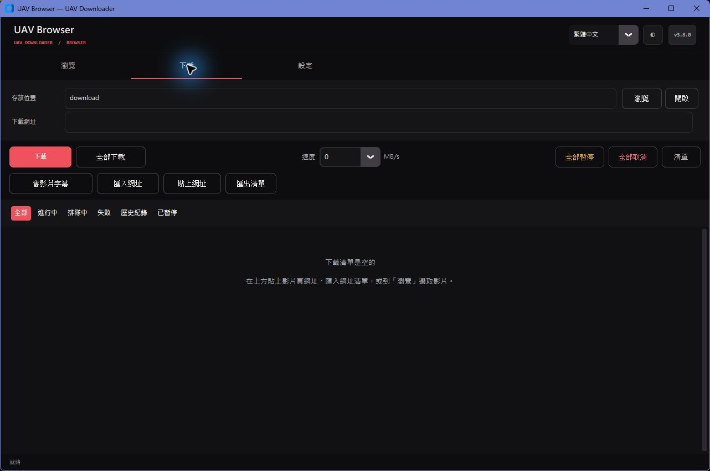

# UAV Downloader v3.8.0 — feature review

Source: [6aaf99b](https://github.com/Alos21750/UAV-Downloader/commit/6aaf99b621da5f531437df3a0c39b58066fac694). Scope: shipped Browser, Watcher (single-file and portable), headless CLI, NAS/Web, shared media core, subtitles, updates and distribution. This is evidence for specific behavior, not a guarantee that every source page, machine or translation works.

## What the review changed

- Browser and Watcher select the AES-128 key/IV per HLS segment, including transitions back to clear segments. Retry diagnostics distinguish HTTP/transfer/decryption/media validation and report sample positions without including signed URLs. MissAV honors a valid Retry-After per job and origin on 429/503.
- Browser offers manual partial export for eligible incomplete MissAV jobs. It verifies a contiguous prefix from segment zero against receipts from this session. It stops at the first gap, preserves the full job/cache, and never overwrites an existing output. [User instructions](../uav-browser.md).
- HLS and SupJav direct downloads recheck cancellation after acquiring bandwidth and before writes. The updater rejects incomplete transfers; CLI URL files accept a UTF-8 BOM; MissAV's base62 parser handles the upper alphabet.
- Whisper no longer discards earlier valid cues when the starting timestamp of a final cue rounds to the exact end of the audio window. Raw malformed timing is still rejected. ReazonSpeech preserves valid windows when another window has no speech; malformed or entirely empty results still trigger fallback.
- Removing a saved API key no longer requires a valid custom endpoint/model. The operation leaves the active provider and other protected profiles intact; keys explicitly set in environment variables are not removed.
- The Web queue accepts the four supported MissAV domains with the same optional `www.` as the desktop adapter. Watcher can recover the site identity for these URLs when saved metadata lacks a site. Web still requires an allowlisted host, valid adapter URL, and HTTPS.

## Whole-suite inventory

[Windows CI](https://github.com/Alos21750/UAV-Downloader/actions/runs/45104152398) passed all 1,469 cases in 81 test modules in 25.64 s. The table assigns each module to one primary area; cross-cutting tests are counted once. The local Windows run passed 1,467 with no failures or errors. The two skipped tests require permission to create symlinks (`test_hls_segment_recovery`, `test_huangguo_collection`); both ran on CI.

| Area | Cases | Representative behavior checked |
| --- | ---: | --- |
| Browser / shared UI / queues | 166 | Selection, queue persistence, scheduling, pause/resume, shutdown, external preview, localized controls |
| Watcher / collections / identity | 261 | Per-site dates, folders and categories, cross-site deduplication, scan recovery, collection ownership and stream compatibility |
| Featured sources | 421 | JableTV, MissAV, SupJav, Hanime1 and Huangguo URL/listing/metadata handling with controlled fixtures |
| Transport / files / recovery | 181 | Aggregate limiter, cancellation, retries, resolution, path handling, storage errors, partial export |
| Subtitles | 340 | VAD/ASR timing, pack verification, local and API translator contracts, SRT provenance, preservation of user edits |
| CLI / NAS / Web | 70 | URL lists, arguments, persisted single-worker queue, restart, assets and authentication |
| Update / packaging / naming | 30 | Truncated transfers, fallbacks, version mirrors, bundled FFmpeg and corresponding source |

## End-to-end checks beyond mocks

| Scenario | Observed result |
| --- | --- |
| Missing segment and resume | Served four 3-second H.264 segments over loopback HTTP: clear, AES with sequence IV, rotated key with explicit IV, clear. Returning HTTP 503 for the last segment twice did not publish a full MP4. The partial decoded to exactly the first 216 frames (9 s). On retry only segment four was fetched; the full 288 frames (12 s) matched the reference pixel-for-pixel. The partial remained unchanged. |
| Shared cap | Three simultaneous curl transfers of 4 MiB at a single 2 MiB/s limit transferred 12 MiB total in 6.0 s. This measures received media bytes across one process, not all OS traffic or instantaneous socket bursts. |
| Huangguo assembly core | Joined two locally generated H.264 episodes. All 48 decoded frames matched their originals in order. A mismatched-resolution pair and an existing output were both rejected without changing the source files or the good output. No automatic transcoding is claimed. |
| Actual local subtitles | CC0 Japanese Common Voice utterance repeated with silence, 18.088 s total; no private media, external API or new model download. Created Japanese, English and Traditional Chinese SRTs using the cached recognition/translation models. Each contained two matching time intervals, 0.360–5.140 and 12.910–17.690. The Japanese matched the reference apart from punctuation; Chinese conveyed the sentence but mistranslated a personal name. This is a pipeline check, not a quality benchmark. |
| Alternate ASR engine | On the same sample, actual whisper.cpp with the Balanced model also produced the two correct Japanese utterances at 0.360–5.360 and 12.910–17.880, without overlap or extra subtitles in the gap. |
| CLI and Web process | The real headless entry point returned CLI help. A loopback-only Web process served the UI, accepted an authenticated synthetic job into a halted queue, cancelled/retried it, then restored the cancelled job after restart. No external downloads. |
| Browser partial-export action | Exercised the actual action handler and FFmpeg with synthetic cached media and simulated confirmation dialogs. Declining made no file; a second click while exporting did not start another worker. Success produced a separate partial MP4, left both cached segments intact and the job incomplete. This controller test is distinct from an automated click on a live site. |

The [container build](https://github.com/Alos21750/UAV-Downloader/actions/runs/45104152520) also ran the actual CLI/Web checks inside both AMD64 and ARM64 images with external networking disabled. The public GHCR `latest` manifests for both architectures were independently read back and matched the source revision above.

The separate [tagged Docker build](https://github.com/Alos21750/UAV-Downloader/actions/runs/45105590535) passed as well. Anonymous registry reads verified that both linux/amd64 and linux/arm64 configs for `ghcr.io/alos21750/uav-downloader:v3.8.0` identify the same source revision.

## Build provenance

All five Windows distribution assets and the three build-input subjects (FFmpeg, corresponding source and provenance JSON) had GitHub attestations for the exact source revision, master ref and Windows workflow on a hosted runner. The FFmpeg embedded in Browser, Watcher and the portable ZIP had SHA-256 `bcbf5b6276c49424b285c438a2d602029fdd820a6ee97ab0128454161f864de4`. The shipped FFmpeg notices matched the build bundle. This is build provenance, not a Microsoft Authenticode signature.

Seven native window checks on local builds and the same seven on the exact CI builds all exited normally: Browser fresh/retained Traditional Chinese and separate English profile; single-file Watcher fresh/retained Simplified Chinese; portable Watcher fresh/retained Japanese. Language selection was checked after restart. The complete five [public release assets](https://github.com/Alos21750/UAV-Downloader/releases/tag/v3.8.0) were anonymously re-downloaded. Their byte lengths and SHA-256 matched CI, the published UTF-8 notes matched the reviewed text and the stable tag resolved to the reviewed commit.

[Feature #71](https://github.com/Alos21750/UAV-Downloader/issues/71#issuecomment-7090699398) was closed after release verification. [PR #67](https://github.com/Alos21750/UAV-Downloader/pull/67#issuecomment-7090700681) was closed as superseded, not merged. [PR #68](https://github.com/Alos21750/UAV-Downloader/pull/68#issuecomment-7090255520) and [PR #69](https://github.com/Alos21750/UAV-Downloader/pull/69#issuecomment-7090701128) remain changes-requested; their entire diffs were not accepted.

## What remains unverified

- The 20 legacy URL-only adapters are not covered by the featured sites' parser fixtures. A live page redesign, upstream rejection or provider outage can still break a download. No live provider video or paid LLM API was used to certify this release.
- Ordinary retry caches are not cryptographically bound to the whole playlist. Partial export's session receipts are a narrower safeguard, not a promise that switching qualities or destinations is safe. Cross-process ownership during shutdown/retry remains a separate review item in [PR #68](https://github.com/Alos21750/UAV-Downloader/pull/68).
- [#70](https://github.com/Alos21750/UAV-Downloader/issues/70) and [#72](https://github.com/Alos21750/UAV-Downloader/issues/72) do not yet supply the reporter's reproducible public page and new diagnostic. A controlled failure is not proof of either reporter's cause. [#54](https://github.com/Alos21750/UAV-Downloader/issues/54), [#57](https://github.com/Alos21750/UAV-Downloader/issues/57), [#59](https://github.com/Alos21750/UAV-Downloader/issues/59) and [#62](https://github.com/Alos21750/UAV-Downloader/issues/62) still need device, storage or network evidence. [#55](https://github.com/Alos21750/UAV-Downloader/issues/55) asks for an embedded player; the shipped preview opens the system browser.
- Windows/DPI/device combinations beyond the release smoke cases, long-term unattended operation on a user's hardware, and recognition/translation accuracy on arbitrary videos are not established by these checks.
