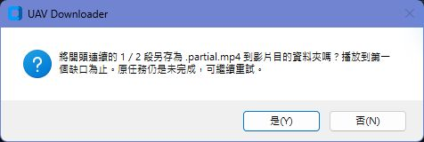

# v3.8.2 recovery verification

Source: [2609563](https://github.com/Alos21750/UAV-Downloader/commit/260956303437feede2f7c34448ffc8dbded5f0bb). The [Windows workflow](https://github.com/Alos21750/UAV-Downloader/actions/runs/45170185278) passed all 1,497 tests. Local Windows passed 1,495 with two existing symlink privilege skips.

- **Before the fix:** an explicit 403 on a missing segment produced 10 requests for the same denied resource. A failed Browser retry followed by queue save/reload lost its verified prefix.
- **Actual HTTP, no third-party media:** a loopback server served four generated H.264 segments with rotating encryption, refused the fourth, then later permitted it. In both unlimited and 2.5 MB/s modes, the refused segment received one request before manual retry. Retry did not fetch the three retained segments. Independent decoding matched the reference for all 216 partial frames and 288 complete frames. Both the local and the official CI FFmpeg were tested.
- **Failure cases:** a simultaneous transient failure remained retryable; a later Watcher source failure retained cache without adding a success to history. The Browser checks reject modified segment bytes and mismatched job receipts, and a partial is never published as the completed movie.
- **Limits:** no test obtains a resource while the origin still denies access. There is no live-video success claim for the reporter's batch. The app cannot reconstruct missing pre-v3.8.2 receipts from filenames alone.

The local and attested builds each passed seven visible Windows launch/close
scenarios for Browser, Watcher, and portable Watcher. In both builds, the
actual Browser Retry button was used on an isolated job with networking
unavailable. After failure and process restart, Export partial returned;
both separate MP4s decoded to the original video frames. The released
build's first MP4 also kept its exact SHA-256 after the second export.

All five [v3.8.2 public assets](https://github.com/Alos21750/UAV-Downloader/releases/tag/v3.8.2)
were anonymously downloaded and matched the verified CI bytes (size and SHA-256).
The [partial-export report](https://github.com/Alos21750/UAV-Downloader/issues/73#issuecomment-7100899538)
was closed. The [provider-availability report](https://github.com/Alos21750/UAV-Downloader/issues/72#issuecomment-7100899563)
remains open for field confirmation.

The [tagged Docker workflow](https://github.com/Alos21750/UAV-Downloader/actions/runs/45173238163)
passed offline checks for AMD64 and ARM64. Anonymous manifest reads for
`latest` and `v3.8.2` resolved both architectures to the tested revision.
