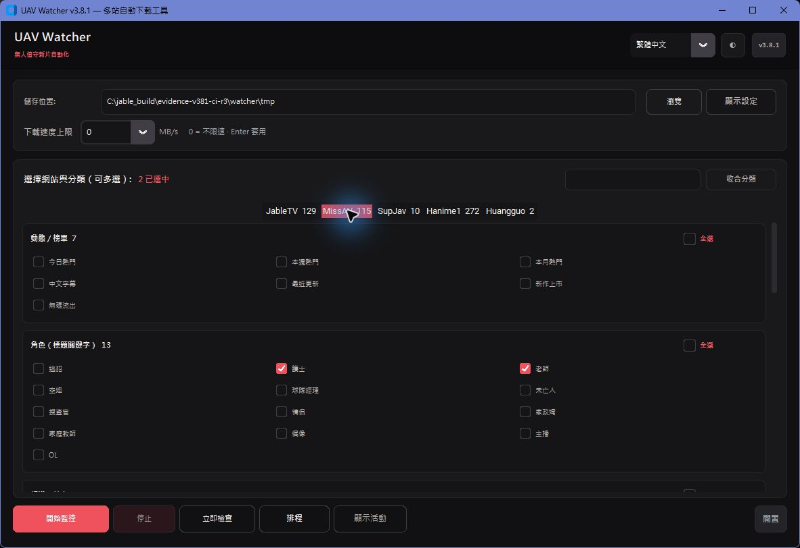

# UAV Downloader v3.8.1 — role tracking and layout verification

Release revision: [738ece3](https://github.com/Alos21750/UAV-Downloader/commit/738ece34584ac74339118f3f5402979bdf4d18b6). User guides: [Watcher](../uav-watcher.md) and [Browser](../uav-browser.md).

| Surface | Check |
| --- | --- |
| Watcher | Real Windows Tk at 1180×780 and 640×500. The category area on the smaller window measured 181 px normally and 133 px with activity open; filter, settings, provider tabs and bottom actions remained reachable. Searching for 護士 in the English UI located Nurse. |
| Browser | At 980 px window width the Hanime1 search field moved to a second row and grew from 211 to 856 px in the measured environment. Returning to 1440 px placed it inline again. The text survived resizing and changing sites. The URL entry and submit button share a row and Enter is bound to the same action. |
| NAS/Web | Headless Chrome with a synthetic long URL: at actual 390 and 752 CSS-pixel viewport widths forms/logs stacked in one column; 1264 px used two. No page-level horizontal overflow or out-of-viewport buttons. Unchanged polls preserve DOM nodes. Tested stale poll ordering, reconnect, late unauthorized responses, logout, keyboard focus and expanded logs. |
| MissAV role scans | Multi-role matches queue a video once. An initial page without a match does not stop subsequent pages. Unrelated titles do not cause date requests or get written to download history. Role-only scans stop after ten recent pages; selecting the whole Latest feed keeps full-feed semantics. Isolated two-process profile test preserved Nurse/OL and site date/folder across a UI language change. |
| Downloads | Four locally generated H.264 segments, including mid-playlist key changes and an unavailable last segment. The exported partial decoded to the first 216 frames; retry fetched only the missing segment and the final 288 decoded frames matched the reference. Compatible collection episodes joined in order; incompatible or pre-existing output was refused without modifying input files. |

## Limits

The 13 roles are local **title keyword** filters, not an official MissAV taxonomy or actor search. They can miss titles without a matching word and can match a word used in another sense. The role-only window is intended for following recent releases, not backfilling an entire catalogue. There was no live video download, paid API call, or access to user media in these checks. The separate missing-segment report in [#72](https://github.com/Alos21750/UAV-Downloader/issues/72) has not been reproduced on the reporter's material.

Measured sizes are from the tested environment, not guarantees for every Windows display, language, font or DPI. This release keeps the existing Python desktop apps; it does not introduce a Tauri migration or change the license.

## Release checks

The [stable release](https://github.com/Alos21750/UAV-Downloader/releases/tag/v3.8.1) is tagged at the tested revision. All five public assets were downloaded without authentication; their lengths and SHA-256 hashes matched the verified CI originals. Seven visible native-window scenarios passed and exited normally for each of the local and CI builds (14/14). The [reply to #72](https://github.com/Alos21750/UAV-Downloader/issues/72#issuecomment-7093101462) distinguishes the shipped role filters from the outstanding missing-segment report.

The [official Windows build](https://github.com/Alos21750/UAV-Downloader/actions/runs/45120720740) passed all 1,491 tests in 39.02 s; local Windows passed 1,489 and skipped two symlink tests because the build account does not have that privilege. The [Docker build](https://github.com/Alos21750/UAV-Downloader/actions/runs/45120721022) passed offline runtime checks on both AMD64 and ARM64. Anonymous registry reads verified both public `latest` images against the release revision.

The [tagged Docker build](https://github.com/Alos21750/UAV-Downloader/actions/runs/45122451377) also passed. An anonymous registry read of `ghcr.io/alos21750/uav-downloader:v3.8.1` confirmed both architectures carry the same tested revision.
