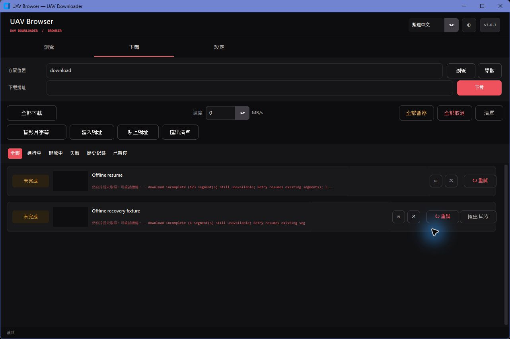

# UAV v3.8.3: what was and wasn't verified

Product revision: [90f3a67](https://github.com/Alos21750/UAV-Downloader/commit/90f3a67b85e86b5ab30234ee35e40c0230743635). The subsequent [Linux workflow commit](https://github.com/Alos21750/UAV-Downloader/commit/fa979b7a68c2a01e2f97efe96cbb0e747a201c4b) only adds CI; it does not change the application or its packaging.

| Report | Evidence and disposition |
| --- | --- |
| [#70](https://github.com/Alos21750/UAV-Downloader/issues/70), [#72](https://github.com/Alos21750/UAV-Downloader/issues/72): MissAV 403 and progress | On a controlled retry with 108 verified segments and 123 missing, one segment received 403 and the other 122 were not requested. Even after a queue save and reload, Browser's actual copy-diagnostics action recorded 46% rather than 0%. Verified later completion on a local HTTP origin after permission returned. Neither this fixture nor a successful URL parse proves the reported videos are available. #70 was closed by the reporter; #72 still needs field confirmation. Its role-tracking feature shipped in v3.8.1. |
| [#74](https://github.com/Alos21750/UAV-Downloader/pull/74): scroll callbacks | Reproduced the stale-path exception on all three UI surfaces before the fix. Unknown Tcl paths no longer throw, real children still route, and unrelated components do not claim the event. Global scaling and the proposed replacement font were not merged. |
| [#54](https://github.com/Alos21750/UAV-Downloader/issues/54), [#57](https://github.com/Alos21750/UAV-Downloader/issues/57): disk errors | Client storage-stop and error-handling cases pass. This cannot diagnose a remote SSD or prove it is safe to write to. No disk stress testing requested. |
| [#59](https://github.com/Alos21750/UAV-Downloader/issues/59), [#62](https://github.com/Alos21750/UAV-Downloader/issues/62): proxy/challenge or loader | Proxy and error-classification tests pass. The local Windows portable artifact contains python312.dll and the two VC runtime DLLs, and the application launches on this machine. Neither that nor a working proxy proves another host has a functioning loader or an authorized connection to a provider. |
| [#55](https://github.com/Alos21750/UAV-Downloader/issues/55): embedded player | Existing preview opens the source in a system browser. The proposed embedded player is a separate unimplemented feature. |
| [#68](https://github.com/Alos21750/UAV-Downloader/pull/68), [#69](https://github.com/Alos21750/UAV-Downloader/pull/69) | Prior reviews still request changes around shutdown/save sequencing and preserving disk errors/recognizing truly empty results, respectively. Neither proposed branch was merged in this release. |

The Windows local suite ran 1,501 passing tests with two symlink tests skipped for lack of host privilege. [Linux CI](https://github.com/Alos21750/UAV-Downloader/actions/runs/45291044100) ran 38 targeted tests, including both symlink cases, without skips. Independent loopback media checks compared all 216 decoded partial frames and 288 decoded complete frames with the generated reference, both unlimited and at a 2.5 MB/s cap. These are checks of client behavior, not a zero-defect guarantee.

[Windows CI](https://github.com/Alos21750/UAV-Downloader/actions/runs/45290596353) passed **1,503 tests, no skips**. Eight build-attestation subjects were verified against the release SHA and the master Windows workflow. The local and exact CI Browser, Watcher and portable Watcher passed eight visible launch/close checks in total. The official Browser exported the synthetic contiguous prefix without marking its source complete; independent decoding matched the original frames. All five [public assets](https://github.com/Alos21750/UAV-Downloader/releases/tag/v3.8.3) were downloaded anonymously and matched the verified CI bytes by length and SHA-256.

[Reporter reply](https://github.com/Alos21750/UAV-Downloader/issues/70#issuecomment-7117505688) · [PR review](https://github.com/Alos21750/UAV-Downloader/pull/74#pullrequestreview-6031434464) · [Container build for the version tag](https://github.com/Alos21750/UAV-Downloader/actions/runs/45292733900).
