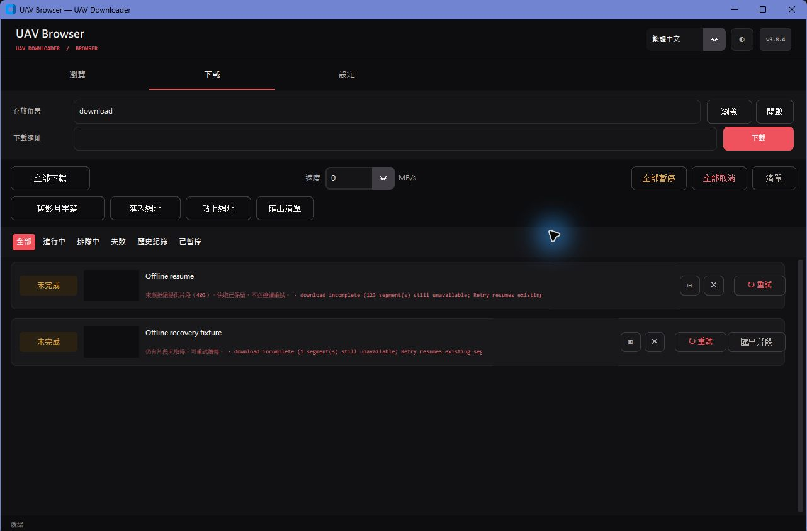

# v3.8.4: upstream refusal and rate-limit audit

Two different user-visible conditions matter in [#72](https://github.com/Alos21750/UAV-Downloader/issues/72). A segment 403 is a refusal of that request. A 429 or 503 with a valid Retry-After names an interval during which the client must stop sending requests to that origin. Neither proves what a provider's internal policy is.

## What changed

- A second MissAV download in the same running application now honors a first download's outstanding Retry-After, keyed by scheme, host and effective port. Separate origins remain independent. State contains no paths, query strings, tokens or response bodies. The cooldown is in memory, not a cross-process or persistent ban.
- Browser identifies explicit segment refusal in existing v3.8.3 saved jobs without making a request. Watcher does not log that refusal as an ordinary retry. The queue and verified media prefix are retained. The ordinary transient-gap path still offers a retry.
- The two submitted screenshots show v3.8.2. Reports from multiple computers and tools are useful comparisons, not proof that an IP was blocked or that v3.8.4 can complete the reported media. No report requires a full-batch retest or disclosure of browser credentials.

## Issues and pull requests

| Item | Disposition |
| --- | --- |
| [#72](https://github.com/Alos21750/UAV-Downloader/issues/72) | Leave open for upstream availability. NJAVTV is a separate provider request, not a fallback and not supported by this release. |
| [#69](https://github.com/Alos21750/UAV-Downloader/pull/69#pullrequestreview-6049643909) | Reviewed rebased head 3522d9f. All available local tests passed (1,516; two symlink skips). Two independent negative fixtures still failed review: a 188-byte non-media tail was accepted, and an HTTP-200 error page with a generic grid looked like valid search results. Changes requested, not merged. |
| [#68](https://github.com/Alos21750/UAV-Downloader/pull/68), [#74](https://github.com/Alos21750/UAV-Downloader/pull/74) | Still conflicting and changes requested. #68 needs safe shutdown/save ordering; #74's scroll exception was addressed in v3.8.3, blanket display scaling was not accepted. |
| [#54](https://github.com/Alos21750/UAV-Downloader/issues/54), [#57](https://github.com/Alos21750/UAV-Downloader/issues/57), [#59](https://github.com/Alos21750/UAV-Downloader/issues/59), [#62](https://github.com/Alos21750/UAV-Downloader/issues/62) | No new diagnostic evidence since the previous review. Remain open for affected-device storage, connection or startup evidence; not reclassified as site rate limits. |
| [#55](https://github.com/Alos21750/UAV-Downloader/issues/55) | Embedded playback is a feature request. The existing Preview action uses the system browser. |

## Verification

Product revision: [93409a4](https://github.com/Alos21750/UAV-Downloader/commit/93409a40c66b199d6acc7ffabac39f7ffd28b188). [Windows build](https://github.com/Alos21750/UAV-Downloader/actions/runs/45517892798) · [Linux regressions](https://github.com/Alos21750/UAV-Downloader/actions/runs/45517892682).

On a real loopback HTTP server, a second job made zero additional same-origin requests before expiry for both 429 and 503. A different port returned 200 immediately, and the original origin returned 200 after the wait. The local Windows suite passed 1,506 tests with two host-privilege skips; Linux passed 50 targeted tests with no skips. The offline legacy-queue test retained 46% progress and the explicit-denial classification. These checks establish client behavior, not availability of external media.

The official Windows job passed all 1,508 tests with no skips. The local and CI builds each passed four visible-window checks: Browser on first run, Browser with a saved queue, Watcher, and portable Watcher. Exporting a verified prefix from the official Browser produced the same decoded frames as the reference and left the job incomplete. Local HTTP recovery and resume were also checked with both unlimited and 2.5 MB/s settings.

All eight build attestations were verified. All five [public release assets](https://github.com/Alos21750/UAV-Downloader/releases/tag/v3.8.4) were independently downloaded without authentication and matched the reviewed CI bytes by length and SHA-256. [Tag container workflow](https://github.com/Alos21750/UAV-Downloader/actions/runs/45519911518).

[Maintainer reply to both new reports](https://github.com/Alos21750/UAV-Downloader/issues/72#issuecomment-7148767918) · [Privacy-safe reporting template](../../.github/ISSUE_TEMPLATE/upstream-media.md).

Official Windows Browser displaying synthetic saved jobs: explicit refusal and ordinary interruption have different next steps.

